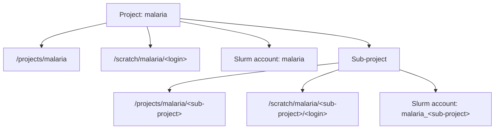

# Projects, sub-projects and roles {#projects-sub-projects-and-roles}

Everything you do on the IGH HPC belongs to a **project**. This page explains what a project gives you, who can do what, and how to keep files usable by your whole team. The examples use a project called `malaria`.

## What a project is {#what-a-project-is}

A project groups the people, data and computing time of one research activity. A project can have **sub-projects** for smaller teams or work packages. Each project (and each sub-project) comes with:

| | Project `malaria` | Sub-project of `malaria` |
|---|---|---|
| Shared folder | `/projects/malaria` | `/projects/malaria/<sub-project>` |
| Scratch space | `/scratch/malaria/<login>` | `/scratch/malaria/<sub-project>/<login>` |
| Slurm account | `malaria` | `malaria_<sub-project>` |



**Access follows membership.** You get access to a project's folders and Slurm account when you are added to the project, and you lose it when you are removed. Nobody is given access to a single folder "by hand".

## Roles {#roles}

| Role | What they can do |
|---|---|
| **Member** | Reads and writes in the project (or in their sub-project) and runs jobs on the project's Slurm account. |
| **Reader** | Can consult the project's data but does not compute on it. |
| **Project admin** (1 or 2 per project) | Asks for members to be added or removed, keeps the project `README.md` up to date, sees and can manage (hold, cancel) the project's jobs, and receives the usage reports. |
| **Cluster administrators** (IT team) | Create projects and manage `/references`, the scratch space and Slurm. |

:::tip
Questions about access to a project, its rules or its data go **first to the project admin**. The project admins are listed in the project `README.md`.
:::

## Who sees what {#who-sees-what}

- **Project members** see the common parts of the project (`data/`, `shared/`, `scripts/`, `results/`, `work/`), but not the inside of its sub-projects.
- **Sub-project members** see their sub-project, plus the common parts of the parent project: `data/raw/` and `data/ref/` read-only, `shared/` read-write. They do not see the other sub-projects.
- A person can be a member of **several sub-projects**.
- **Project admins** see the whole project and all its sub-projects.

## Project folder layout {#folder-layout}

Every project folder has the same structure:

```text
/projects/malaria/
├── README.md            # project rules and admins (edited by the project admins)
├── data/
│   ├── raw/             # raw data: links to the sequencing runs, READ-ONLY
│   └── ref/             # references specific to the project
├── scripts/             # scripts and pipelines (git recommended)
├── results/             # results, one sub-folder per person
│   └── slurm_logs/      # job logs
├── shared/              # exchanges between members, including sub-projects
├── work/                # intermediate files, NOT backed up
├── rapports/            # usage reports (project admins)
└── <sub-project>/       # same structure as the project
    ├── README.md
    ├── data/raw/
    ├── data/ref/
    ├── scripts/
    ├── results/
    │   └── slurm_logs/
    └── work/
```

- `data/raw/` contains **links** to the sequencing runs, not copies. Never modify or duplicate raw data.
- `work/` is for intermediate files and is **not backed up**. Keep what matters in `results/`.
- Shared reference genomes and databases live in `/references`, see [Storage](../hardware/storage.md).

## File permissions in a project {#file-permissions}

Inside a project folder, new files automatically **belong to the project** and can be modified by the whole team. Copying files while **keeping their original permissions** breaks this rule: your colleagues then get `Permission denied`.

Use:

```bash
cp -r my_folder /projects/malaria/results/$USER/
rsync -rlt my_folder /projects/malaria/results/$USER/
```

Avoid when the destination is a project folder: `cp -p`, `cp -a`, `rsync -a`, and `mv` from your home directory.

If a colleague gets `Permission denied` on something you copied, fix it with:

```bash
chmod -R g+rwX /projects/malaria/my_folder
```

:::info
If **you** get `Permission denied` right after being added to a project, log out and log in again: new memberships only take effect in a new session.
:::

## Check your projects {#check-your-projects}

```bash
groups                                              # projects you belong to
id                                                  # same, with more details
sacctmgr show assoc user=$USER format=account,qos   # your Slurm accounts and QOS
```

Charge every job to a project account, for example `#SBATCH --account=malaria` or `#SBATCH --account=malaria_<sub-project>`. See [Your first job](first-job.md).

## Project life cycle {#life-cycle}

1. **Creation:** someone opens a ticket on <Var name="supportPortal" link /> asking for a new project.
2. **Project admins** are designated.
3. **Members** are added at the request of the project admins.
4. **Work:** the team computes, stores and shares data in the project. Project admins receive usage reports in `rapports/`.
5. **Closure:** when the project ends, the IT team archives it.

## Related pages {#related-pages}

- [Getting access](accounts.md)
- [Storage](../hardware/storage.md)
- [File system good practice](../good-conduct/file-system.md)
- [Job submission good practice](../good-conduct/job-submission.md)
- [hpcsub, the IGH submission command](../tutorials/running-jobs/hpcsub.md)
