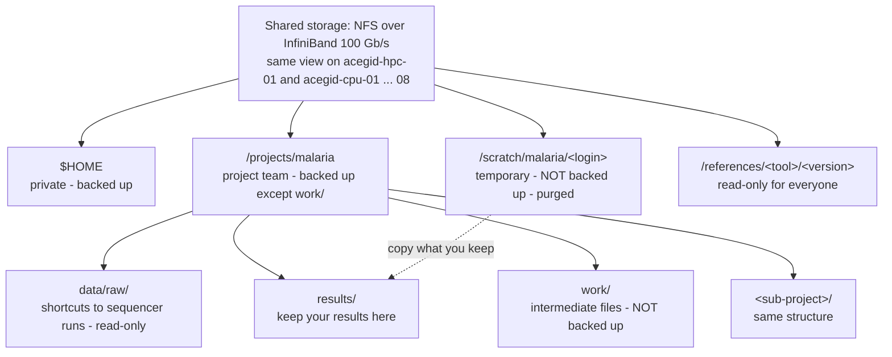

All storage on the <Var name="clusterName" /> cluster is a high-availability NFS system, connected over InfiniBand 100 Gb/s. It looks exactly the same from the login node and from every compute node: a file you write in a job is immediately visible on the login node, and vice versa.

## Storage spaces {#storage-spaces}

| Space | Purpose | Backed up | Rules |
|-------|---------|-----------|-------|
| `$HOME` | Personal, private directory | Yes | Scripts and configuration files; no large datasets |
| `/projects/<project>[/<sub-project>]` | Project data and results | Yes (except `work/`) | Shared by the project team |
| `/scratch/<project>/<login>` (`/scratch/<project>/<sub-project>/<login>`) | Running computations, large temporary files | **No** | Fast SSDs; files unused for <Var name="scratchPurgeDays" /> days are deleted |
| `/references/<tool>/<version>` | Shared reference genomes and databases | — | Read-only for everyone; maintained by the IT team |
| Project `data/raw/` | Sequencer runs (shortcuts) | Yes | Read-only; never modify or duplicate |

The diagram below shows these spaces for the example project `malaria`:



How projects, sub-projects and their folders are organised is described in [Projects, sub-projects and roles](../getting-started/projects.md).

## Home directory {#home}

`$HOME` is your private directory. It is backed up. Use it for:

- scripts and configuration files (`.bashrc`, editor settings…);
- small personal software installs and conda environments (see [Installing your own software](../software/custom-install.md)).

Do **not** keep large datasets or analysis results in `$HOME`: they belong in your project.

## Project directories {#projects}

Each project (and sub-project) has a shared directory, for example `/projects/malaria` or `/projects/malaria/<sub-project>`. This is where the team keeps its data, scripts and results.

- Everything is backed up **except `work/`**, which is for intermediate files.
- New files created in a project directory automatically belong to the project and can be modified by the whole team. Some copy commands break this rule: see [Copying files into a project](../good-conduct/file-system.md#copying-into-a-project).

## Scratch {#scratch}

Each project member has a scratch space: `/scratch/malaria/<login>` (or `/scratch/malaria/<sub-project>/<login>` for a sub-project). It is on fast SSDs and is meant for running computations and large temporary files.

:::danger Scratch is not backed up and is purged
- Files not used for **<Var name="scratchPurgeDays" /> days** are deleted automatically, with **<Var name="scratchNoticeDays" /> days'** notice.
- Deleted files **cannot be recovered**.
- Copy everything you want to keep to `/projects/<project>/results`.
:::

```bash
# At the end of an analysis, keep the final results in the project
cp -r /scratch/malaria/<login>/run42/final /projects/malaria/results/<login>/run42
```

## Reference databases {#references}

Shared reference genomes and databases are installed under `/references`, one directory per tool and per version, for example `/references/kraken2/2026-11`. They are read-only for everyone and maintained by the IT team.

```bash
kraken2 --db /references/kraken2/2026-11 sample.fastq
```

- Available databases include Kraken2, BLAST (nr), DIAMOND, GTDB-Tk, Bakta and snpEff.
- Always use an explicit version in your scripts, and **cite that version** in your papers.
- Need a database that is not there? Open a ticket on <Var name="supportPortal" link /> rather than downloading it yourself.

## Raw sequencing data {#raw-data}

Sequencing data are never copied into projects. A project's `data/raw/` directory contains **shortcuts** (links) to the sequencer runs.

- `data/raw/` is read-only: never modify or duplicate raw data.
- Read the data directly from `data/raw/` in your jobs.
- `cp -a` or `rsync -a` on a shortcut copies the link, not the data.

## Node-local /tmp {#node-tmp}

The compute nodes have no local disk: `/tmp` lives in memory and uses the RAM of your job's node. Do not write large files to `/tmp`; use your scratch space instead.

## Backups {#backups}

| Space | Backed up |
|-------|-----------|
| `$HOME` | Yes |
| `/projects/...` | Yes, **except `work/`** |
| Raw data (`data/raw/`) | Yes |
| `/scratch/...` | **Never** |

Even so, keep your own copy of anything irreplaceable.

## Space usage {#space-usage}

The space used is monitored per user and per project. Please use it reasonably:

- clean up `work/` and your scratch space regularly;
- do not duplicate data (raw data, references, other members' results);
- check the size of your own directories with `du -sh`.

Old or inactive data may be cleaned up. For good practices, see [File system practices](../good-conduct/file-system.md).
