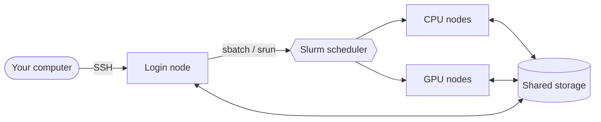

The **Institute of Genomics and Global Health (IGH)**, formerly ACEGID, operates a High Performance Computing (HPC) cluster to support genomics, bioinformatics and data-intensive research.

This wiki is the reference for everyone using the cluster: how to get access, how to run work efficiently, and where to get help.

## How the cluster works

You log in to a **login node**, prepare your work, and hand it to the **Slurm** scheduler, which runs it on the **compute nodes** when resources are free. Your files live on **shared storage** visible from every node.

## Start here

1. [Get an account](getting-started/accounts)
2. [Connect to the cluster](getting-started/connecting)
3. [Run your first job](getting-started/first-job)
4. Read the [good conduct](good-conduct/overview) rules — the cluster is shared.

## At a glance

| | |
|---|---|
| **Scheduler** | <Var name="scheduler" /> |
| **Login host** | <Var name="loginHost" code /> |
| **Support** | <Var name="supportEmail" link /> |
| **Support hours** | <Var name="supportHours" /> |

:::tip[Français]
This wiki is also available in French — use the language menu in the top bar.
:::
