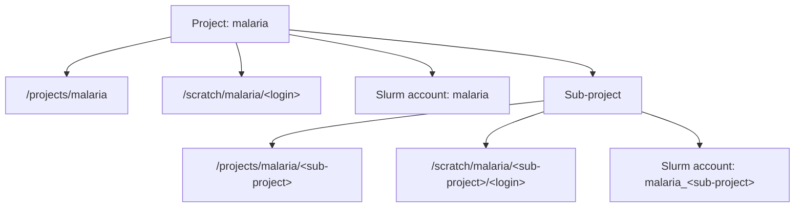

# Projets, sous-projets et rôles {#projects-sub-projects-and-roles}

Tout ce que vous faites sur le HPC de l'IGH est rattaché à un **projet**. Cette page explique ce qu'un projet vous apporte, qui peut faire quoi, et comment garder vos fichiers utilisables par toute l'équipe. Les exemples utilisent un projet nommé `malaria`.

## Qu'est-ce qu'un projet ? {#what-a-project-is}

Un projet regroupe les personnes, les données et le temps de calcul d'une activité de recherche. Il peut comporter des **sous-projets** pour des équipes plus petites ou des volets de travail. Chaque projet (et chaque sous-projet) dispose de :

| | Projet `malaria` | Sous-projet de `malaria` |
|---|---|---|
| Dossier partagé | `/projects/malaria` | `/projects/malaria/<sub-project>` |
| Espace scratch | `/scratch/malaria/<login>` | `/scratch/malaria/<sub-project>/<login>` |
| Compte Slurm | `malaria` | `malaria_<sub-project>` |



**L'accès suit l'appartenance au projet.** Vous accédez aux dossiers et au compte Slurm d'un projet quand vous y êtes ajouté, et vous perdez cet accès quand vous en êtes retiré. Personne ne reçoit d'accès à un dossier isolé « à la main ».

## Rôles {#roles}

| Rôle | Ce qu'il peut faire |
|---|---|
| **Membre** | Lit et écrit dans le projet (ou dans son sous-projet) et lance des jobs sur le compte Slurm du projet. |
| **Lecteur** | Consulte les données du projet, mais ne calcule pas dessus. |
| **Admin de projet** (1 ou 2 par projet) | Demande l'ajout ou le retrait de membres, tient à jour le `README.md` du projet, voit et peut gérer (suspendre, annuler) les jobs du projet, et reçoit les rapports de consommation. |
| **Administrateurs du cluster** (équipe IT) | Créent les projets et gèrent `/references`, le scratch et Slurm. |

:::tip
Les questions sur l'accès à un projet, ses règles ou ses données s'adressent **d'abord à l'admin de projet**. Les admins de projet sont indiqués dans le `README.md` du projet.
:::

## Qui voit quoi {#who-sees-what}

- Les **membres du projet** voient les parties communes du projet (`data/`, `shared/`, `scripts/`, `results/`, `work/`), mais pas l'intérieur des sous-projets.
- Les **membres d'un sous-projet** voient leur sous-projet ainsi que les parties communes du projet parent : `data/raw/` et `data/ref/` en lecture seule, `shared/` en lecture-écriture. Ils ne voient pas les autres sous-projets.
- Une personne peut être membre de **plusieurs sous-projets**.
- Les **admins de projet** voient tout le projet et tous ses sous-projets.

## Arborescence d'un projet {#folder-layout}

Tous les dossiers de projet ont la même structure :

```text
/projects/malaria/
├── README.md            # règles du projet et admins (édité par les admins de projet)
├── data/
│   ├── raw/             # données brutes : liens vers les runs de séquençage, LECTURE SEULE
│   └── ref/             # références propres au projet
├── scripts/             # scripts et pipelines (git conseillé)
├── results/             # résultats, un sous-dossier par personne
│   └── slurm_logs/      # journaux des jobs
├── shared/              # échanges entre membres, y compris des sous-projets
├── work/                # fichiers intermédiaires, NON sauvegardé
├── rapports/            # rapports de consommation (admins de projet)
└── <sub-project>/       # même structure que le projet
    ├── README.md
    ├── data/raw/
    ├── data/ref/
    ├── scripts/
    ├── results/
    │   └── slurm_logs/
    └── work/
```

- `data/raw/` contient des **liens** vers les runs de séquençage, pas des copies. Ne modifiez ni ne dupliquez jamais les données brutes.
- `work/` sert aux fichiers intermédiaires et **n'est pas sauvegardé**. Gardez ce qui compte dans `results/`.
- Les génomes et bases de référence partagés se trouvent dans `/references`, voir [Stockage](../hardware/storage.md).

## Droits sur les fichiers d'un projet {#file-permissions}

Dans un dossier de projet, les nouveaux fichiers **appartiennent automatiquement au projet** et sont modifiables par toute l'équipe. Copier des fichiers **en conservant leurs droits d'origine** annule cette règle : vos collègues obtiennent alors `Permission denied`.

À utiliser :

```bash
cp -r my_folder /projects/malaria/results/$USER/
rsync -rlt my_folder /projects/malaria/results/$USER/
```

À éviter quand la destination est un dossier de projet : `cp -p`, `cp -a`, `rsync -a`, et `mv` depuis votre répertoire personnel.

Si un collègue obtient `Permission denied` sur un élément que vous avez copié, corrigez avec :

```bash
chmod -R g+rwX /projects/malaria/my_folder
```

:::info
Si c'est **vous** qui obtenez `Permission denied` juste après avoir été ajouté à un projet, déconnectez-vous puis reconnectez-vous : un nouvel accès n'est pris en compte que dans une nouvelle session.
:::

## Vérifier vos projets {#check-your-projects}

```bash
groups                                              # projets dont vous êtes membre
id                                                  # idem, avec plus de détails
sacctmgr show assoc user=$USER format=account,qos   # vos comptes Slurm et QOS
```

Imputez chaque job à un compte de projet, par exemple `#SBATCH --account=malaria` ou `#SBATCH --account=malaria_<sub-project>`. Voir [Votre premier job](first-job.md).

## Cycle de vie d'un projet {#life-cycle}

1. **Création :** une personne ouvre un ticket sur <Var name="supportPortal" link /> pour demander un nouveau projet.
2. Les **admins de projet** sont désignés.
3. Les **membres** sont ajoutés à la demande des admins de projet.
4. **Travail :** l'équipe calcule, stocke et partage ses données dans le projet. Les admins de projet reçoivent les rapports de consommation dans `rapports/`.
5. **Fermeture :** à la fin du projet, l'équipe IT l'archive.

## Pages liées {#related-pages}

- [Obtenir un accès](accounts.md)
- [Stockage](../hardware/storage.md)
- [Bonnes pratiques du système de fichiers](../good-conduct/file-system.md)
- [Bonnes pratiques de soumission](../good-conduct/job-submission.md)
- [hpcsub, la commande de soumission de l'IGH](../tutorials/running-jobs/hpcsub.md)
