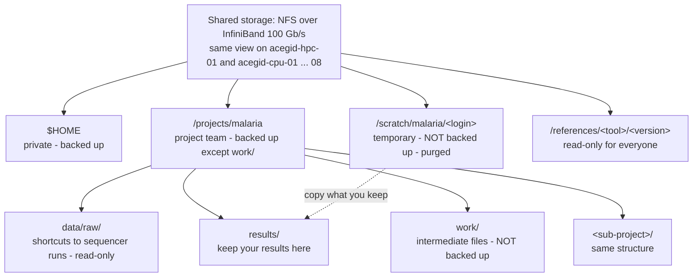

Tout le stockage du cluster <Var name="clusterName" /> repose sur un système NFS à haute disponibilité, relié en InfiniBand 100 Gb/s. Il est vu exactement de la même façon depuis le nœud de connexion et depuis chaque nœud de calcul : un fichier écrit dans un job est immédiatement visible sur le nœud de connexion, et inversement.

## Les espaces de stockage {#storage-spaces}

| Espace | Rôle | Sauvegardé | Règles |
|--------|------|------------|--------|
| `$HOME` | Dossier personnel, privé | Oui | Scripts et fichiers de configuration ; pas de gros jeux de données |
| `/projects/<project>[/<sub-project>]` | Données et résultats du projet | Oui (sauf `work/`) | Partagé par l'équipe du projet |
| `/scratch/<project>/<login>` (`/scratch/<project>/<sub-project>/<login>`) | Calculs en cours, gros fichiers temporaires | **Non** | SSD rapides ; les fichiers non utilisés depuis <Var name="scratchPurgeDays" /> jours sont supprimés |
| `/references/<tool>/<version>` | Génomes et bases de référence partagés | — | Lecture seule pour tous ; mis à jour par l'équipe IT |
| `data/raw/` du projet | Runs des séquenceurs (raccourcis) | Oui | Lecture seule ; ne jamais modifier ni dupliquer |

Le schéma ci-dessous montre ces espaces pour le projet d'exemple `malaria` :



L'organisation des projets, des sous-projets et de leurs dossiers est décrite dans [Projets, sous-projets et rôles](../getting-started/projects.md).

## Dossier personnel {#home}

`$HOME` est votre dossier privé. Il est sauvegardé. Utilisez-le pour :

- vos scripts et fichiers de configuration (`.bashrc`, réglages de l'éditeur…) ;
- de petites installations logicielles personnelles et vos environnements conda (voir [Installer ses propres logiciels](../software/custom-install.md)).

N'y gardez **pas** de gros jeux de données ni de résultats d'analyse : leur place est dans votre projet.

## Dossiers de projet {#projects}

Chaque projet (et sous-projet) dispose d'un dossier partagé, par exemple `/projects/malaria` ou `/projects/malaria/<sub-project>`. C'est là que l'équipe range ses données, ses scripts et ses résultats.

- Tout est sauvegardé **sauf `work/`**, réservé aux fichiers intermédiaires.
- Les nouveaux fichiers créés dans un dossier de projet appartiennent automatiquement au projet et sont modifiables par toute l'équipe. Certaines commandes de copie cassent cette règle : voir [Copier des fichiers dans un projet](../good-conduct/file-system.md#copying-into-a-project).

## Scratch {#scratch}

Chaque membre d'un projet dispose d'un espace scratch : `/scratch/malaria/<login>` (ou `/scratch/malaria/<sub-project>/<login>` pour un sous-projet). Il est sur des SSD rapides et sert aux calculs en cours et aux gros fichiers temporaires.

:::danger Le scratch n'est pas sauvegardé et il est nettoyé
- Les fichiers non utilisés depuis **<Var name="scratchPurgeDays" /> jours** sont supprimés automatiquement, avec un préavis de **<Var name="scratchNoticeDays" /> jours**.
- Les fichiers effacés sont **irrécupérables**.
- Copiez tout ce que vous voulez garder dans `/projects/<project>/results`.
:::

```bash
# En fin d'analyse, gardez les résultats finaux dans le projet
cp -r /scratch/malaria/<login>/run42/final /projects/malaria/results/<login>/run42
```

## Bases de référence {#references}

Les génomes et bases de référence partagés sont installés sous `/references`, un dossier par outil et par version, par exemple `/references/kraken2/2026-11`. Ils sont en lecture seule pour tous et mis à jour par l'équipe IT.

```bash
kraken2 --db /references/kraken2/2026-11 sample.fastq
```

- Bases disponibles, entre autres : Kraken2, BLAST (nr), DIAMOND, GTDB-Tk, Bakta et snpEff.
- Indiquez toujours une version explicite dans vos scripts, et **citez cette version** dans vos articles.
- Besoin d'une base absente ? Ouvrez un ticket sur <Var name="supportPortal" link /> plutôt que de la télécharger vous-même.

## Données de séquençage brutes {#raw-data}

Les données de séquençage ne sont jamais copiées dans les projets. Le dossier `data/raw/` d'un projet contient des **raccourcis** (liens) vers les runs des séquenceurs.

- `data/raw/` est en lecture seule : ne modifiez ni ne dupliquez jamais les données brutes.
- Lisez les données directement depuis `data/raw/` dans vos jobs.
- `cp -a` ou `rsync -a` sur un raccourci copient le lien, pas les données.

## /tmp des nœuds {#node-tmp}

Les nœuds de calcul n'ont pas de disque local : `/tmp` est en mémoire et consomme la RAM du nœud de votre job. N'y écrivez pas de gros fichiers ; utilisez votre espace scratch.

## Sauvegardes {#backups}

| Espace | Sauvegardé |
|--------|------------|
| `$HOME` | Oui |
| `/projects/...` | Oui, **sauf `work/`** |
| Données brutes (`data/raw/`) | Oui |
| `/scratch/...` | **Jamais** |

Gardez malgré tout votre propre copie de tout ce qui est irremplaçable.

## Espace occupé {#space-usage}

L'espace occupé est suivi par utilisateur et par projet. Merci d'en faire un usage raisonnable :

- nettoyez régulièrement `work/` et votre scratch ;
- ne dupliquez pas les données (données brutes, références, résultats des autres membres) ;
- vérifiez la taille de vos propres dossiers avec `du -sh`.

Les données anciennes ou inactives sont susceptibles d'être nettoyées. Pour les bonnes pratiques, voir [Pratiques du système de fichiers](../good-conduct/file-system.md).
