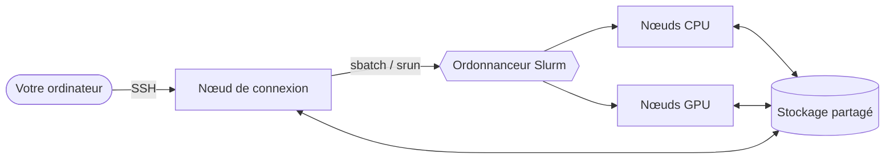

L'**Institute of Genomics and Global Health (IGH)**, anciennement ACEGID, exploite un cluster de calcul haute performance (HPC) au service de la recherche en génomique, en bio-informatique et en sciences des données.

Ce wiki est la référence pour tous les utilisateurs du cluster : comment obtenir un accès, comment travailler efficacement et où trouver de l'aide.

## Fonctionnement du cluster

Vous vous connectez à un **nœud de connexion**, vous préparez votre travail, puis vous le confiez à l'ordonnanceur **Slurm**, qui l'exécute sur les **nœuds de calcul** dès que des ressources sont libres. Vos fichiers se trouvent sur un **stockage partagé** accessible depuis tous les nœuds.

## Par où commencer

1. [Obtenir un compte](getting-started/accounts)
2. [Se connecter au cluster](getting-started/connecting)
3. [Lancer votre premier job](getting-started/first-job)
4. Lire les [bonnes pratiques](good-conduct/overview) — le cluster est partagé.

## En bref

| | |
|---|---|
| **Ordonnanceur** | <Var name="scheduler" /> |
| **Hôte de connexion** | <Var name="loginHost" code /> |
| **Assistance** | <Var name="supportEmail" link /> |
| **Horaires d'assistance** | <Var name="supportHours" /> |

:::tip[English]
Ce wiki est aussi disponible en anglais — utilisez le menu de langue dans la barre du haut.
:::
